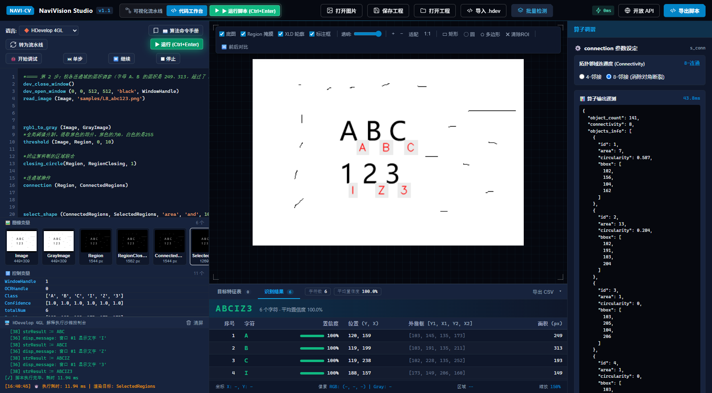

# NaviVision Studio (OpenDevelop) 机器视觉平台

<p align="center">
  <b>轻量级交互式机器视觉 IDE · HALCON / HDevelop 开源平替</b><br>
  可视化算子流水线 · HDevelop 4GL 脚本引擎（含单步调试） · 形状匹配 · 可训练 OCR · 免安装 Windows 客户端
</p>

<p align="center">
  
  
  
  
</p>

<p align="center"></p>

---

## 下载（Windows 客户端）

**[前往 Releases 下载 `NaviVisionStudio.exe`](https://github.com/philo-max/NaviVision-Studio/releases/latest)** —— 单个 exe，约 95 MB，不需要安装 Python，双击即用。

| 项目 | 说明 |
| :--- | :--- |
| 系统要求 | 64 位 Windows 10 / 11 |
| 界面组件 | 使用 Microsoft Edge WebView2；Windows 11 自带，个别 Windows 10 需先装 [WebView2 运行时](https://developer.microsoft.com/microsoft-edge/webview2/) |
| 首次启动 | 单文件版要先把自身解压到临时目录，首次打开可能要等十几秒，请耐心等待 |
| SmartScreen / 杀毒提示 | 没有购买代码签名证书，会提示“未知发布者”：点“更多信息”→“仍要运行”。个别杀毒软件对 PyInstaller 程序误报，可自行从源码构建 |
| 数据位置 | 训练文件（`.trf`）、分类器（`.omc`）、输出文本默认保存在 `%LOCALAPPDATA%\NaviVisionStudio\workspace`，可用环境变量 `NAVIVISION_WORKSPACE` 修改 |

校验：Release 页面附有 SHA256，下载后可用 `certutil -hashfile NaviVisionStudio.exe SHA256` 核对。

---

## 功能概览

### 1. 可视化流水线
- 算子卡片串联、拖动调参、按步骤查看中间结果；级联指纹缓存（上游参数一变，下游缓存自动失效，未变步骤 0 ms 复用）。
- ROI 交互（矩形 / 圆 / 多边形）、分支与多图（`input_from` / `merge_images`）、一维卡尺测量、批量检测并导出 CSV 报告。
- `.nvproj` 工程文件一键保存 / 打开；可导出独立的 Python / OpenCV 代码。

### 2. HDevelop 4GL 脚本引擎（代码工作台）
- 解析并执行 `.hdev` / `.hdvp` 与纯文本脚本，支持 `(In : Out : CtrlIn : CtrlOut)` 四槽位语法、`for` / `while` / `if` / `switch`、元组运算、HALCON 风格字符串转义。
- 与 HDevelop 相似的使用体验：语法高亮、**图像变量窗口**（缩略图）、**控制变量窗口**、视口目标切换、开始调试 / 单步 / 继续 / 停止、`disp_message` 窗口文字（支持中文）、算法命令手册（共 96 条，带示例）。
- 可视化流水线与脚本**双向转换**；脚本一键导入。
- 已实现约 110 个常用算子，包括：图像 / 区域 / 形态学、仿射变换（`hom_mat2d_*`、`affine_trans_image`、`rotate_image`）、区域特征与外接形状（`smallest_rectangle1/2`、`smallest_circle`、`sort_region`）、文件与字符串（`list_files`、`tuple_regexp_select`）等。未实现的算子会明确报错，不会悄悄跳过。

### 3. 形状模板匹配
`create_shape_model` / `find_shape_model` / `find_scaled_shape_model` 等：多目标、多尺度、多角度、金字塔由粗到精，并给出亚像素位置与得分。*灰度 NCC 实现，非 HALCON 基于边缘方向的算法，得分不会逐位一致。*

### 4. 字符识别（OCR）
- **内置字库**：`Industrial_*` / `DotPrint_*` / `Document_*` 等名称可直接 `read_ocr_class_mlp`（用多字体合成样本训练的 kNN）。
- **自己训练**：`create_ocr_class_mlp` → `append_ocr_trainf` → `trainf_ocr_class_mlp` → `write_ocr_class_mlp`，分类器为 OpenCV MLP；`.trf` 为 JSON-lines，`.omc` 为 JSON + XML，**不使用 pickle**，加载文件不会执行代码。
- 完整流程：ROI → 二值化（`binary_threshold` / `char_threshold`）→ 形态学 → `connection` → `select_shape` → `sort_region` → `do_ocr_multi_class_mlp`，图像倾斜时可先用 `smallest_rectangle2` 取角度再 `rotate_image` 矫正。
- 示例脚本在 [`assignment/ocr/`](assignment/ocr)（数字、字母数字、汉字、车牌、训练 / 检测、考核共 11 个），对应图片在 `samples/`；`test_ocr_scripts.py` 会端到端运行它们。

### 5. 其他算子
`filter`（均值 / 高斯 / 中值）、`rgb_to_hsv` / `hsv_threshold`、`edges_subpix`（Canny + 法向抛物线亚像素）、`measure_region`（OBB、外接圆、惯性主轴、凸度）、`gen_contour_polygon`、`read_barcode`（QR；装 `pyzbar` 后支持一维码 / Data Matrix）、`calibrate`（棋盘格比例标定）、`read_text`（可选 Tesseract）、`onnx_inference`（可选 onnxruntime）。可选依赖缺失时会明确提示并优雅降级。

### 6. 安全与会话
- 在线 Python 脚本默认**关闭**，仅限受信任本机；启用需设置 `NAVIVISION_ENABLE_SCRIPT_RUNNER=1`，启用后 AST 静态审查 + 子进程隔离 + 超时熔断。
- HDevelop 脚本在受限解释器内运行（表达式用安全 AST 求值，不使用 `eval`）：单次运行 30 秒超时，文件读写限定在工作区目录内。
- 多会话隔离（`X-Session-ID`），可选磁盘持久化（`NAVIVISION_SESSION_DIR`）。

---

## 与 HALCON 的差异（请务必了解）

| 项目 | 说明 |
| :--- | :--- |
| 内置字库 | 为合成样本训练的 kNN，对点阵喷码等特殊字体识别较差，需自己训练；不实现拒识（Rej）字库 |
| OCR 训练 | MLP 的字符归一化由内部固定，`create_ocr_class_mlp` 的宽高 / 特征参数仅作兼容；训练误差定义与 HALCON 不同 |
| `char_threshold` | 近似实现（平滑直方图 + 大津法），`Percent` 参数不参与计算 |
| `draw_*` 算子 | 脚本一次性运行，读取运行前在视口里画好的 ROI |
| 形状匹配 | 灰度 NCC，非边缘方向模型 |
| 亚像素边缘 | Canny 整像素边缘 + 法向插值，非 Steger 脊线检测 |
| 标定 | 仅平面比例系数，无相机内参 / 畸变 |

---

## 从源码运行

```bash
pip install -r requirements.txt
python app.py            # 浏览器访问 http://127.0.0.1:8080
python launcher.py       # 或以桌面窗口运行（需要 pywebview）
```

批量检测接口：`POST /api/v1/batch-predict`，multipart 的 `files` 传图（最多 25 张），`rules` 传 JSON 规则，如 `{"min_objects": 1, "max_objects": 20}`。

### 测试
```bash
python -m pytest -q      # 全部 102 项
```
GitHub Actions 在 push / PR 时运行 `test_core.py`、`test_api_contract.py`、`test_hdev.py`（Python 3.10 / 3.12）。OCR 与形状匹配的测试（`test_ocr_*.py`、`test_shape_matching.py`）依赖本地字体和样本，请在本地运行。

### 构建 Windows 客户端
```powershell
.\build_windows.ps1            # 文件夹版 -> dist\NaviVisionStudio\（需整个文件夹一起发布）
.\build_windows_onefile.ps1    # 单文件版 -> dist_onefile\NaviVisionStudio.exe
```

---

## 目录结构

```text
├── app.py                     # FastAPI 服务入口（REST API / 页面挂载 / 会话路由）
├── launcher.py                # 桌面客户端启动器（pywebview）
├── core/
│   ├── operators.py           # 流水线算子库
│   ├── pipeline.py            # 级联指纹缓存执行引擎
│   ├── hdev_engine.py         # HDevelop 4GL 解析 / 解释 / 调试 / 转译
│   ├── hdev_expr.py           # 安全表达式求值器
│   ├── hdev_geometry.py       # 仿射变换与图像几何
│   ├── text_region_ops.py     # 区域外接形状、排序、二值化
│   ├── shape_model.py / shape_search.py   # 形状模板匹配
│   ├── ocr_chars.py / ocr_mlp.py          # 内置字库与可训练 MLP 分类器
│   ├── file_ops.py / workspace.py         # 文件算子与工作区限制
│   ├── session_manager.py     # 多会话管理
│   ├── script_runner.py / script_worker.py  # 在线 Python 脚本沙箱
│   └── code_generator.py      # Python / OpenCV 代码生成
├── static/                    # Web 前端（index.html、css/、js/ 含语法高亮与算法命令手册）
├── samples/                   # 示例图片
├── assignment/ocr/            # 字符识别示例脚本（.hdev）
├── test_*.py                  # 测试套件
├── NaviVisionStudio*.spec     # PyInstaller 配置（文件夹版 / 单文件版）
└── build_windows*.ps1         # 构建脚本
```

## 算子映射（节选）

| NaviVision Studio | HALCON 对标 | 说明 |
| :--- | :--- | :--- |
| `read_image` / `rgb1_to_gray` | `read_image` / `rgb1_to_gray` | 读取图像 / 转灰度 |
| `threshold` / `auto_threshold` | `threshold` / `auto_threshold` | 双阈值 / 大津法分割 |
| `connection` / `select_shape` | `connection` / `select_shape` | 连通域 / 按面积、圆度、矩形度、Hu 矩筛选 |
| `morphology` | `dilation` / `erosion` / `opening` / `closing` | 形态学 |
| `find_shape_model` | `find_shape_model` | 多目标、多尺度、多角度匹配 |
| `measure_region` / `measure_pos` | `smallest_rectangle2` / `measure_pos` | 外接形状与特征 / 一维卡尺 |
| `reduce_domain` | `reduce_domain` | ROI 归约 |
| `read_ocr_class_mlp` 等 | `read_ocr_class_mlp` 等 | OCR 字库与训练 |

完整算子与示例见软件内“算法命令手册”。
